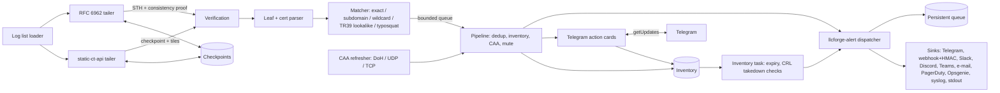

# Herald Architecture

Certificate Transparency log monitor. Alerts the second a new TLS certificate is issued for your domains, for a lookalike or typosquat of them, or by a CA your CAA records do not allow.

This document describes how Herald is put together, where its trust boundaries are and how it behaves when things go wrong. It is the starting point for contributors; keep it up to date when you change the design.

## Design principles

- **Self-hosted, single binary.** No SaaS dependency, no external database. State (checkpoints, dedup state, inventory, alert queue, silences) lives in a local data directory.
- **Fail safe and loud.** Missing or stale input is reported as such; silence is never treated as "all clear". An unreadable checkpoint stops that log's tailer with an error instead of silently skipping ahead. A CAA lookup failure keeps the last known policy instead of producing violations.
- **Verify, then trust.** Tree head signatures, consistency between tree heads and (for tiled logs) the hash of every data tile are checked before entries are used.
- **Untrusted input everywhere.** CT entries, tiles, checkpoints, log list, DNS answers, CRLs, crt.sh rows and Telegram updates are parsed defensively: HTTP bodies are capped at 32 MiB, TLS-style and DNS length prefixes are bounds checked, there is no `unsafe` code.
- **Secrets from the environment.** Tokens are read from environment variables, never from config files or logs. HTTP errors are logged without the request URL, which for Telegram contains the bot token.
- **Cross-platform.** Pure Rust (rustls, ring); no OS-specific code in Herald itself. Service integration (Windows SCM, systemd, launchd) comes from llcforge-alert.

## Data flow



## Components

| Component | Source | Responsibility |
|---|---|---|
| **CLI / supervisor** | `src/main.rs` | `run`, `check-config`, `inspect`, `test-alert`, `backfill`, `report`, `silence`, `service`. Starts an *instance* (dispatcher, notifier, tailers, background tasks) from a configuration; on reload it stops the instance (checkpoints are already on disk) and starts a new one. The management listener (metrics, health, silences, reload) lives across reloads. |
| **Config** | `src/config.rs` | TOML via serde with `deny_unknown_fields`; translates the 0.1 `[alerts] stdout/telegram/webhook` keys into `[[alerts.sink]]`; validation and domain normalisation (IDNA to lowercase punycode). |
| **Log list loader** | `src/loglist.rs` | Google's log list v3: RFC 6962 `logs` and static-ct-api `tiled_logs` in state `usable` / `qualified` whose `temporal_interval` has not ended. The checkpoint origin of a tiled log is its submission URL without scheme and trailing slash. |
| **RFC 6962 client** | `src/ct.rs` | `get-sth`, `get-entries`, `get-sth-consistency`, capped body reads, TreeHeadSignature verification (`ring`: ECDSA P-256 or RSA PKCS#1 with SHA-256), MerkleTreeLeaf parsing. |
| **static-ct-api client** | `src/tiled.rs` | Checkpoint (signed note) parsing and RFC 6962 note signature verification (key ID = `SHA-256(origin ‖ 0x0A ‖ 0x05 ‖ LogID)[:4]`), tile path encoding (`x001/x234/067`, `.p/<W>`), partial-to-full tile fallback, data tile (`TileLeaf`) parsing with the `leaf_index` extension. |
| **Merkle** | `src/merkle.rs` | Leaf/node hashing, MTH, RFC 9162 consistency proof verification, and `TileTree`: computes any tree hash from tiles, optionally substituting a locally computed hash for one range (a data tile), and reports which tiles it still needs. |
| **Log tailer** | `src/tailer.rs` | One tokio task per log (start staggered by 250 ms). RFC 6962: poll the STH, verify the signature, verify consistency with the last verified head, fetch pages in parallel, process in order. Tiled: fetch the checkpoint, verify it, recompute old and new roots from the same tiles, fetch data tiles in parallel, bind each tile to the signed root, process in order. Adaptive parallelism (AIMD), checkpoint after each page/tile, exponential backoff. |
| **Certificate parser** | `src/cert.rs` | `x509-parser` over the leaf certificate or the TBSCertificate of a precertificate. Extracts SAN DNS names, CN, issuer O/CN/DN, serial, validity and HTTP(S) CRL distribution points. |
| **Confusables** | `src/confusables.rs`, `data/confusables-compact.txt` | Unicode TR39 table (generated by `tools/gen_confusables.py`, embedded with `include_str!`, parsed once) and the case-insensitive skeleton. |
| **Matcher** | `src/matcher.rs` | Per-domain exact / subdomain / wildcard rules, TR39 lookalikes, typosquats (Damerau-Levenshtein, bitflip, TLD swap, combo); `expected_issuers` marks matches as muted (never impersonations). |
| **Pipeline** | `src/notify.rs` | Dedup (issuer + serial), inventory recording, CAA evaluation, muting, conversion to the `llcforge.alert.v1` schema (resource = watched domain, id = `herald:<kind>:<domain>:<serial>`), Telegram action cards. |
| **Dedup** | `src/dedup.rs` | (issuer DN, serial) to first-seen time, capped at 100k keys, persisted to `dedup.json` every 30 s and on shutdown. |
| **CAA** | `src/caa.rs` | DNS message encoder/decoder (CAA only, name compression skipped safely), DoH (RFC 8484 POST), UDP with TCP fallback on truncation, RFC 8659 tree climbing, built-in issuer to CAA identifier map, background refresher. |
| **Inventory** | `src/inventory.rs` | Every matched certificate (merged precert/final), verdicts, revocation state; `inventory.json` written atomically; hostname report; expiry detection; crt.sh backfill. |
| **CRL** | `src/crl.rs` | Fetches and parses CRLs (`x509-parser`), caches per URL until `nextUpdate` (1 to 6 hours). |
| **Telegram actions** | `src/tgactions.rs` | Card sender (1 msg/s) and `getUpdates` poller; authorises presses by chat id and user allowlist; applies verdicts, silences and `cert_suspicious` alerts. |
| **Checkpoints** | `src/checkpoint.rs` | One JSON file per log (`<data_dir>/checkpoints/<first 16 bytes of sha256(url), hex>.json`): next index plus last verified tree size and root. Atomic write helper used by all state files. |
| **Metrics** | `src/metrics.rs` | Herald counters and gauges plus the dispatcher's `llcforge_alert_*` metrics at `GET /metrics`. |
| **llcforge-alert** | `crates/llcforge-alert` | Vendored shared crate: alert schema, dispatcher, sinks, persistent queue, silences, health, reload, logging, service. |

## Verification model

- **RFC 6962 logs.** The STH signature is verified with the log key. The checkpoint file keeps the last verified (size, root). A new head of size `n` must come with a valid `get-sth-consistency` proof from the old size `m`. A smaller `n` (a lagging frontend) must be proven to be a prefix of the verified tree and is then skipped. Entries from `get-entries` are not individually proven (no inclusion proofs); they come from a log whose heads are signed and consistent.
- **Tiled logs.** The checkpoint must carry a valid RFC 6962 note signature by the log key under the origin name. The old root `m` and the new root `n` are both computed from the hash tiles of tree `n` and compared with the stored root and the checkpoint root; this proves consistency. Each data tile's leaf hashes are computed locally, combined to the tile's subtree hash and used, together with the hash tiles, to recompute the checkpoint root: an entry that is not in the signed tree cannot be processed. The `leaf_index` extension must match the position.
- A failure is counted, logged, raised as a critical `log_inconsistent` alert, and the head is rejected; the tailer retries with backoff.

## Checkpoint semantics

The checkpoint stores the index of the next entry to fetch and the last verified tree head. It is written after every page or data tile, once all matches from it have been handed to the alert pipeline. On restart a tailer resumes from the checkpoint; with no checkpoint it starts at the current tree size minus `backfill`. On shutdown or reload, in-flight fetches are cancelled (nothing from them was processed yet) and the pipeline is drained. Alerts accepted by the dispatcher are written to its persistent queue before delivery, so a crash after that point does not lose them.

## Trust boundaries

| Boundary | Data | Controls |
|---|---|---|
| CT logs -> Herald | STHs, checkpoints, tiles, entries (attacker-influenced: anyone can get a certificate with crafted names) | Signatures, consistency, tile binding; bounded parsers; every certificate-derived string truncated, escaped by each sink, control characters removed for text output. |
| Log list -> Herald | Which logs and keys are trusted | HTTPS from the configured URL. |
| DNS resolver -> Herald | CAA records | Bounded parser, response id check (UDP/TCP), HTTPS for DoH. A spoofed answer can at worst mute or raise CAA alerts; use DoH or a trusted resolver. |
| CRL servers -> Herald | Revocation lists (plain HTTP, unsigned from Herald's view) | Size cap, parse errors are "unknown"; results are informational. |
| crt.sh -> Herald | Backfill rows | Bounded, validated, only names matching your rules are stored. |
| Telegram -> Herald | Button presses (`getUpdates`) | Only the configured chat id and `allowed_user_ids`; callback data must reference a card Herald sent (unguessable 64-bit token); effects limited to verdicts, a bounded silence and one alert. |
| Operators -> management listener | `/metrics`, `/healthz`, `/readyz`, `/v1/silences`, `POST /v1/reload` | Binds where configured (loopback by default in the examples); admin routes require a bearer token from the environment and are not mounted without one. |
| Herald -> sinks | Alerts | Secrets from the environment; webhook HMAC signatures; no redirects followed. |

## Failure modes

| Situation | Behaviour |
|---|---|
| Log returns 429 / 5xx / network error | That tailer halves its parallelism and backs off exponentially up to 10 minutes; `herald_fetch_errors_total` and `herald_log_lag_entries` show it. Other logs are unaffected. |
| Tile not published yet (404 right after a checkpoint) | Partial tiles fall back to the full tile; otherwise the cycle is retried with backoff. |
| Signature / consistency / tile hash failure | Head rejected, counted (`herald_sth_verify_failures_total`, `herald_consistency_failures_total`), `log_inconsistent` alert, retried with backoff. |
| Malformed entry | Counted in `herald_entries_malformed_total` and skipped (its hash is still part of tile verification). |
| Log retired or removed from the list | Its tailer is stopped at the next list refresh. |
| Log list unreachable | Running tailers continue; the list is retried after 60 seconds. |
| A sink is down | llcforge-alert retries with backoff, keeps the alert in the persistent queue and redelivers; other sinks are unaffected. |
| CAA lookup fails | The last known policy is kept; without one, CAA does not mute or alarm. |
| crt.sh unavailable | `herald backfill` fails with a clear error; nothing is written. |
| Inventory file corrupt | Startup fails with an error (it holds user verdicts); move it away to start fresh. Corrupt dedup state is ignored with a warning (worst case a duplicate alert). |
| Invalid configuration on reload | Logged; the running instance continues with the old configuration. |

## Runtime model

- tokio multi-threaded runtime; one task per log so a slow or hostile log cannot block the others.
- A bounded `mpsc` channel connects the tailers to the pipeline task, which owns the dedup state and hands alerts to the dispatcher with a non-blocking `send`.
- Background tasks: CAA refresher, inventory task (save every 60 s, checks every `check_interval_secs`), Telegram card sender and poller.
- `herald run` and `herald service run` run the daemon on a dedicated thread with its own runtime (required by the Windows service dispatcher). Shutdown on Ctrl+C, SIGTERM or the service manager; reload on SIGHUP (Unix), config file change (all OSes) or `POST /v1/reload`.

## Repository layout

```
Herald/
├── .github/                   CI (Linux, macOS, Windows), release, dependabot
├── assets/                    logos, icons, README images
├── crates/llcforge-alert/     vendored shared alerting crate (sync.py)
├── data/                      TR39 confusables (compact) + Unicode licence
├── deploy/                    Grafana dashboard, Prometheus rules, Helm chart
├── packaging/                 deb/rpm metadata, systemd, launchd, Windows service, Homebrew, Scoop, winget
├── src/
│   ├── main.rs                CLI, supervisor, reload, inventory task
│   ├── config.rs              configuration, legacy translation, validation
│   ├── loglist.rs             CT log list v3 (RFC 6962 + tiled)
│   ├── ct.rs                  RFC 6962 client, leaf parsing, signatures
│   ├── tiled.rs               static-ct-api client and parsers
│   ├── merkle.rs              hashing, consistency proofs, tile tree
│   ├── tailer.rs              per-log tailing loops, adaptive parallelism
│   ├── cert.rs                X.509 field extraction
│   ├── confusables.rs         TR39 skeletons
│   ├── matcher.rs             domain, lookalike and typosquat rules
│   ├── notify.rs              alert pipeline and rendering
│   ├── dedup.rs               persistent precert / cert deduplication
│   ├── caa.rs                 CAA over DoH / UDP / TCP
│   ├── inventory.rs           inventory, report, expiry, crt.sh backfill
│   ├── crl.rs                 CRL revocation checks
│   ├── tgactions.rs           Telegram inline buttons
│   ├── checkpoint.rs          atomic per-log checkpoints
│   └── metrics.rs             Prometheus metrics
├── tools/gen_confusables.py   regenerates data/confusables-compact.txt
├── herald.example.toml        annotated example configuration
├── ARCHITECTURE.md            this file
├── README.md                  English documentation
└── README.tr.md               Turkish documentation
```

Unit tests live next to the code they test (`#[cfg(test)]` modules); test certificates and CRLs are generated at test time with `rcgen`, Merkle trees and tiles are built in memory.

## Related tools

- [Vigil](https://github.com/LLCForge/Vigil): Real-time origin hijack detection over public RIPE RIS and RouteViews feeds. Flags the moment someone else announces your prefix.
- [Notary](https://github.com/LLCForge/Notary): RPKI Route Origin Validation checker. Tells you whether your prefixes are RPKI-valid and watches third-party ASes, in milliseconds.
- [Pathology](https://github.com/LLCForge/Pathology): BGP route monitor for your own routers and BMP feeds. Learns the AS paths and origins your prefixes normally use, then alerts on any deviation.
