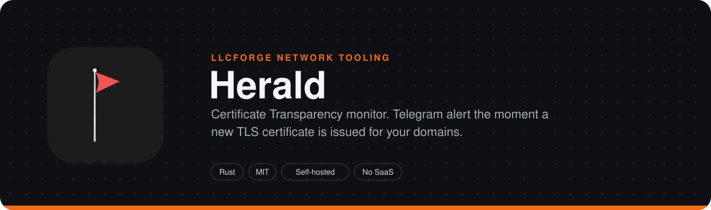
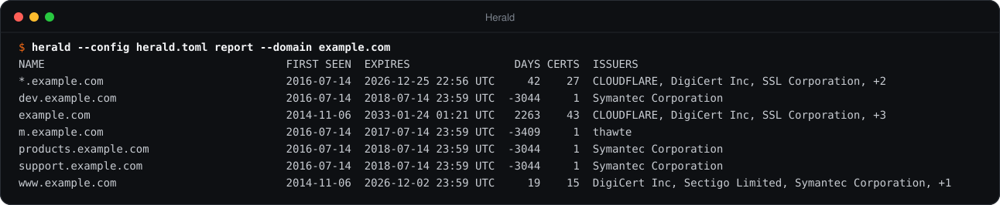
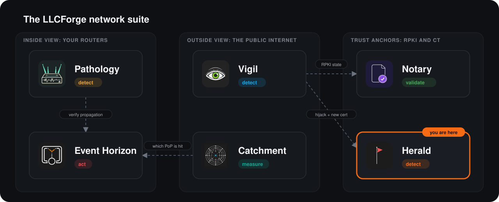

> **LLCForge network tooling** — self-hosted, Rust, no SaaS.
> [Pathology](https://github.com/LLCForge/Pathology) · [Event Horizon](https://github.com/LLCForge/Event-Horizon) · [Catchment](https://github.com/LLCForge/Catchment) · [Notary](https://github.com/LLCForge/Notary) · **Herald** · [Vigil](https://github.com/LLCForge/Vigil)

<!-- readme-visuals -->
<p align="center">
  
</p>

<p align="center">Certificate Transparency log monitor. Alerts the second a new TLS certificate is issued for your domains, for a lookalike or typosquat of them, or by a CA your CAA records do not allow.</p>

<p align="center">
  <strong>English</strong> · <a href="README.tr.md">Türkçe</a>
</p>

<p align="center">
  <a href="LICENSE"></a>
  
  
</p>

---

## Why

Every publicly trusted TLS certificate must be logged in Certificate Transparency. That means a certificate issued for your domain by someone else (a phishing kit, a compromised DNS account, a mis-issuing CA) is visible to you within seconds, if you are watching. Herald watches the logs directly, without relying on a third-party search service.

## Demo

<p align="center">
  
</p>

<sub>Real output of `herald --config herald.toml report --domain example.com`, with the inventory filled from public CT data by `herald backfill`.</sub>

## Features

- **Both CT log APIs.** RFC 6962 logs (`get-sth`, `get-entries`) and static-ct-api tiled logs ([c2sp.org/static-ct-api](https://c2sp.org/static-ct-api): checkpoint, hash tiles, gzip data tiles), including the Let's Encrypt, Google, Sectigo, Geomys, GoDaddy and TrustAsia tiled logs. Logs come from Google's CT log list v3 (states `usable` / `qualified`, shard not ended), re-read daily; a static list can replace it.
- **Verified, not trusted.** Every tree head signature is checked (ECDSA P-256 / RSA via `ring`; for tiled logs the RFC 6962 note signature in the checkpoint, with the key ID defined by the spec). Consecutive tree heads must be consistent: RFC 6962 `get-sth-consistency` proofs for classic logs; for tiled logs the old and the new root are both recomputed from the same tiles. Every data tile is hashed and bound to the signed root before its entries are used. A failure raises a critical `log_inconsistent` alert.
- **Adaptive parallelism.** Pages / data tiles are fetched in parallel; parallelism grows while a log is behind and halves on HTTP 429 / 5xx (between 1 and `fetch_concurrency`). Tailers start staggered. Backoff up to 10 minutes per log.
- **Exact resume.** Per-log checkpoints (next index + last verified tree head) are written atomically after every page or tile.
- **Matching:** exact name, subdomains, wildcards; **lookalikes** with the full Unicode TR39 confusables table (`exаmple`, `examp1e`, `exarnple`); **typosquats**: Damerau-Levenshtein distance, single bit flips, TLD swaps (`example.net` for `example.org`) and combo names (`example-login`, `secure-example`).
- **CAA.** For `caa = true` domains Herald resolves CAA (DNS-over-HTTPS, UDP or TCP; RFC 8659 tree climbing; `issue` / `issuewild`) and treats the CAs it allows as expected issuers. A certificate from any other CA raises a critical `caa_violation` alert.
- **Inventory.** Every matched certificate is kept in `<data_dir>/inventory.json`. `herald backfill` seeds it from crt.sh, `herald report` lists every host name seen for your domains (text, Markdown, JSON), and Herald warns when the newest certificate of one of your names is about to expire with no renewal in CT.
- **Takedown tracking.** Lookalike, typosquat and suspicious certificates are re-checked against their CRL distribution points (cached per URL); a revocation is reported.
- **Alerts through [llcforge-alert](crates/llcforge-alert):** Telegram, HMAC-signed webhook, Slack, Discord, Teams, e-mail, PagerDuty, Opsgenie, syslog, stdout. Persistent delivery queue, per-sink retries and rate limits, silences (`herald silence`, `/v1/silences`) and per-domain recipients: the alert resource is the watched domain, so `resources = ["example.org"]` routes that domain to one sink.
- **Telegram buttons.** Optional action cards with *Known*, *Suspicious* and *Mute* buttons (`getUpdates` long polling, user allowlist).
- **Restart-safe dedup.** A precertificate and its final certificate alert once; the state survives restarts.
- **Operations:** `/metrics`, `/healthz`, `/readyz`, JSON or text logs, configuration reload (SIGHUP, file change, `POST /v1/reload`), Windows service / systemd / launchd, Docker, Helm, Grafana dashboard and Prometheus rules in `deploy/`.
- `herald inspect` shows what Herald would alert for a certificate file (optionally with live CAA and CRL checks).

## Where it fits in the suite

Herald is the suite's application-layer sentinel: [Vigil](https://github.com/LLCForge/Vigil) tells you someone is announcing your IP space, Herald tells you someone just got a certificate for your name. A BGP hijack followed by a fresh certificate for the same service is the classic interception pattern; running both closes that gap.

<p align="center">
  
</p>

## Quick start

> **Status:** pre-release. Configuration keys and CLI flags may change before 1.0.

Requirements: a stable Rust toolchain 1.85 or newer ([rustup.rs](https://rustup.rs)). No system libraries are needed (TLS is rustls) on Linux, macOS or Windows.

```bash
git clone https://github.com/LLCForge/Herald.git
cd Herald
cargo build --release
cp herald.example.toml herald.toml      # then edit the [[domain]] entries
export HERALD_TELEGRAM_TOKEN="123456789:AA..."
./target/release/herald --config herald.toml check-config
./target/release/herald --config herald.toml backfill   # optional: seed the inventory from crt.sh
./target/release/herald --config herald.toml run
```

Minimal `herald.toml` (every other key has a default; [herald.example.toml](herald.example.toml) lists them all):

```toml
[[domain]]
name = "example.net"
include_subdomains = true
caa = true                             # CAs allowed by CAA are expected; others alarm

[[domain]]
name = "example.org"
lookalikes = true
typosquats = true

[[alerts.sink]]
type = "telegram"
bot_token_env = "HERALD_TELEGRAM_TOKEN"
chat_id = -1001234567890
```

Secrets are always read from the environment variables named in the config, never from the config file itself. Configurations written for Herald 0.1 (`[alerts] stdout`, `[alerts.telegram]`, `[alerts.webhook]`) still load: they are translated into `[[alerts.sink]]` entries.

## Installation

| Platform | How |
|---|---|
| Linux (Debian/Ubuntu) | `sudo apt install ./herald_<version>_amd64.deb` from the release page; edit `/etc/herald/herald.toml`, put secrets in `/etc/herald/herald.env`, then `sudo systemctl enable --now herald`. The unit (`packaging/systemd/herald.service`) runs with `DynamicUser=yes`, `StateDirectory=herald` and a strict sandbox; `systemctl reload herald` re-reads the configuration. |
| Linux (RHEL/Fedora/openSUSE) | `sudo dnf install ./herald-<version>.x86_64.rpm`, then the same systemd steps. |
| macOS | `brew install LLCForge/tap/herald` (formula in `packaging/homebrew/`) or the release tarball. Run it in the background with `packaging/launchd/net.llcforge.herald.plist`; `herald service install` prints the exact `launchctl` steps. |
| Windows | `scoop install herald` (manifest in `packaging/scoop/`) or `winget install LLCForge.Herald`. As a service: `packaging/windows/install-service.ps1` from an elevated PowerShell, or `herald --config C:\ProgramData\LLCForge\herald\herald.toml service install`. See [packaging/windows/README.md](packaging/windows/README.md). |
| Docker | `docker compose up -d` with [docker-compose.yml](docker-compose.yml) (read-only root, no capabilities, state in the `/data` volume). Set `[metrics] listen = "0.0.0.0:9898"` inside the container. |
| Kubernetes | `helm install herald deploy/helm/herald -f my-values.yaml`; the chart probes `/healthz` and `/readyz` on port 9898 and can create a ServiceMonitor. |
| From source | `cargo install --path .` (any OS with Rust 1.85+). |

Herald needs no special privileges on any OS: it only makes outbound HTTPS connections (and DNS ones with `caa.resolver = "udp://..."` or `"tcp://..."`) and listens on the management port you configure.

## Usage

```text
herald [--config <FILE>] <COMMAND>

  run                       Tail the CT logs and send alerts (Ctrl+C / SIGTERM stops cleanly)
  check-config              Validate the configuration and report missing environment variables
  inspect FILE [--caa] [--revocation]
                            Show what Herald would alert for a certificate (PEM or DER)
  test-alert                Send a test alert through every configured sink
  backfill [--domain D]     Seed the inventory from crt.sh (no alerts)
  report [--format text|markdown|json] [--domain D]
                            Every host name seen in CT for your domains, with expiry
  silence add|list|remove   Silences / maintenance windows
  service install|uninstall|run
                            Windows service; prints systemd / launchd steps on Unix
```

`--config` defaults to `herald.toml`. `HERALD_LOG` (for example `HERALD_LOG=debug`) overrides the `[logging]` level. Logs go to stderr; the stdout sink prints alerts to stdout.

### Alert kinds

| Kind | Severity | When |
|---|---|---|
| `certificate` | warning | A new certificate for one of your names from an issuer that is not expected |
| `lookalike` | critical | A homoglyph lookalike of your domain (TR39 skeleton match) |
| `typosquat` | critical | Edit distance, bit flip, TLD swap or combo name |
| `caa_violation` | critical | Issuer not allowed by the domain's CAA records |
| `cert_expiring` | warning | The newest certificate of one of your names expires within `expiry_warn_days`; resolved when a renewal appears |
| `cert_revoked` | info | A tracked lookalike / typosquat / suspicious certificate was revoked |
| `cert_suspicious` | critical | Someone pressed *Suspicious* on a Telegram card |
| `log_inconsistent` | critical | A CT log served tree heads that are not consistent |

Every alert's `resource` is the watched domain (the CT log URL for `log_inconsistent`), so sink filters such as `resources = ["example.org"]` and `kinds = ["lookalike", "typosquat"]` give per-domain recipients.

### Setting up Telegram

1. Open a chat with [@BotFather](https://t.me/BotFather), send `/newbot` and follow the prompts. BotFather replies with a token such as `123456789:AA...`.
2. Put the token in the environment, never in the config: `export HERALD_TELEGRAM_TOKEN="123456789:AA..."`.
3. Find the chat id:
   - Private chat: send any message to your bot, then open `https://api.telegram.org/bot<TOKEN>/getUpdates` and read `message.chat.id` (a positive number).
   - Group: add the bot to the group, send a message there and read `chat.id` from the same `getUpdates` call (negative; supergroups start with `-100`).
   - Public channel: add the bot as an administrator and use `chat_id = "@yourchannel"`.
4. Add a `[[alerts.sink]]` with `type = "telegram"` and run `herald test-alert`.

**Buttons.** With `[telegram_actions]` Herald also posts each certificate alert as a card with *Known* (records the verdict in the inventory), *Suspicious* (verdict, a critical `cert_suspicious` alert and revocation tracking) and *Mute Nd* (a silence for that domain and alert kind). Use a separate bot for the cards: only one program may call `getUpdates` for a bot. Presses are honoured only in the configured chat and only from `allowed_user_ids`.

### Webhook signatures

With `hmac_secret_env` set, every webhook request carries `X-LLCForge-Timestamp` and `X-LLCForge-Signature: sha256=<hex>` = HMAC-SHA256(secret, `"<timestamp>.<raw body>"`). Reject requests older than five minutes. A Python receiver is in the [llcforge-alert README](crates/llcforge-alert/README.md#verifying-webhook-signatures).

### Configuration reference

| Key | Default | Meaning |
|---|---|---|
| `data_dir` | `$STATE_DIRECTORY` or `herald-data` | Checkpoints, dedup state, inventory, alert queue, silences |
| `logs.list_url` | Google log list v3 | CT log list to load |
| `logs.include_tiled` | `true` | Also tail static-ct-api logs from the list |
| `logs.list_refresh_secs` | `86400` | How often the log list is re-read (minimum 60) |
| `logs.poll_interval_secs` | `10` | How often each log's tree head / checkpoint is polled |
| `logs.batch_size` | `256` | Entries per `get-entries` page (1 to 1024; lowered automatically to the log's cap) |
| `logs.fetch_concurrency` | `4` | Maximum parallel pages / data tiles per log (1 to 64); the tailer adapts below it |
| `logs.backfill` | `0` | On a log's first start, begin this many entries before the tree head |
| `logs.verify_sth` | `true` | Verify signatures, consistency and tile hashes |
| `[[logs.static]]` | none | `url`, optional `key` (base64 SPKI), `description`, `tiled`, `origin`; replaces the log list |
| `dedup.window_secs` | `86400` | Window in which a precert and its final cert alert once |
| `[[domain]] name` | required | Domain to watch (Unicode names are converted to punycode) |
| `include_subdomains` | `false` | Match any name under the domain |
| `wildcards` | `true` | Match `*.<name>` |
| `lookalikes` | `false` | TR39 confusable lookalikes |
| `typosquats` / `typo_distance` | `false` / `1` | Typosquat detection; maximum edit distance 1 to 3 |
| `caa` | `false` | Expected issuers from CAA, `caa_violation` otherwise |
| `expected_issuers` | `[]` | Issuer O or CN values (case-insensitive) whose matches are muted |
| `[alerts]`, `[[alerts.sink]]` | one stdout sink | See [llcforge-alert](crates/llcforge-alert/README.md#configuration); common sink keys `resources`, `kinds`, `min_severity`, `rate_per_minute` |
| `caa.resolver` | `https://cloudflare-dns.com/dns-query` | DoH URL, `udp://host[:port]` or `tcp://host[:port]` |
| `caa.refresh_secs` | `3600` | CAA re-resolution interval |
| `[caa.issuer_domains]` | built-in table | Extra issuer-organisation to CAA identifier mappings |
| `inventory.expiry_warn_days` | `14` | Expiry warning window (0 disables) |
| `inventory.check_interval_secs` | `3600` | Expiry and revocation check interval |
| `inventory.revocation_check` | `true` | CRL checks for tracked lookalikes / typosquats |
| `inventory.max_certs` | `100000` | Inventory size bound |
| `[telegram_actions]` | none | `bot_token_env`, `chat_id`, `allowed_user_ids`, `mute_days` (`7`) |
| `[silences] api_token_env` | none | Mounts `/v1/silences` |
| `[health] admin_token_env` | none | Mounts `POST /v1/reload` |
| `[logging] format` / `level` | `text` / `info` | `json` for one object per line |
| `metrics.listen` | none | Management listener: `/metrics`, `/healthz`, `/readyz` and the admin APIs. `[health] listen` is used when `[metrics]` is absent. |

Unknown keys are rejected, so a typo fails at startup instead of being ignored. A configuration reload restarts the tailers from their checkpoints; changing the management listener address needs a process restart.

### How lookalike and typosquat detection works

Every certificate name is decoded from punycode to Unicode and reduced to a skeleton: lowercase, Herald's small extra map (digits `0 1 3 5` read as `o l e s`, Cyrillic and Greek letters that look Latin), NFD, the full Unicode TR39 confusables mapping (6,700+ entries, for example `rn` for `m`), NFD again, combining marks removed. If the skeleton equals your domain's skeleton, or ends with `.<skeleton>`, while the real name is not under your domain, it is a lookalike.

Typosquats compare the registrable part of the name (as many trailing labels as your domain has, so `example.co.uk` compares three labels) with your domain: same suffix and Damerau-Levenshtein distance up to `typo_distance` (`exampel`, `exmple`, `examples`), a single bit flip (`exampme`), the same label under another suffix (`example.net`), or your label inside a longer label (`example-login`, `secure-example`; labels of four or more characters only). There is no Public Suffix List, so combo names on short labels can be noisy.

## Roadmap

- CRL signatures are not verified (Herald sees the leaf or TBS certificate in CT, not a trusted issuer certificate), so revocation results are informational. OCSP is not used.
- Partial data tiles of tiled logs are fetched on every poll instead of waiting for the full tile (simpler, slightly more traffic).
- Typosquat detection has no Public Suffix List; the registrable part is the last N labels, N being the label count of your configured domain.
- The CAA issuer map covers the large public CAs; others need `[caa.issuer_domains]`. CAA is evaluated for the watched domain (with tree climbing), not per subdomain.
- Backfill reads crt.sh only; a full historical scan of the logs themselves is not implemented (`logs.backfill` covers recent entries).
- Telegram action cards are separate messages from the regular Telegram sink (the shared sink has no button support).

## How it works

See [ARCHITECTURE.md](ARCHITECTURE.md) for components, data flow, trust boundaries and failure modes.

## Related tools

- [Vigil](https://github.com/LLCForge/Vigil): Real-time origin hijack detection over public RIPE RIS and RouteViews feeds. Flags the moment someone else announces your prefix.
- [Notary](https://github.com/LLCForge/Notary): RPKI Route Origin Validation checker. Tells you whether your prefixes are RPKI-valid and watches third-party ASes, in milliseconds.
- [Pathology](https://github.com/LLCForge/Pathology): BGP route monitor for your own routers and BMP feeds. Learns the AS paths and origins your prefixes normally use, then alerts on any deviation.

## Contributing

Issues and pull requests are welcome. Read [CONTRIBUTING.md](CONTRIBUTING.md) and the [Code of Conduct](CODE_OF_CONDUCT.md) first. Found a vulnerability? Do **not** open a public issue; follow [SECURITY.md](SECURITY.md).

## License

Herald is free and open-source software released under the [MIT License](LICENSE). See [NOTICE](NOTICE) for attributions.
