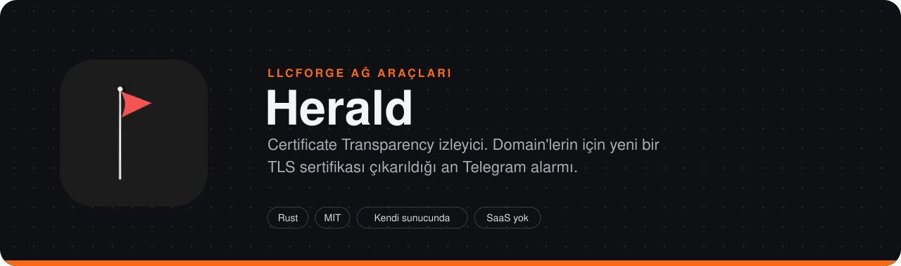
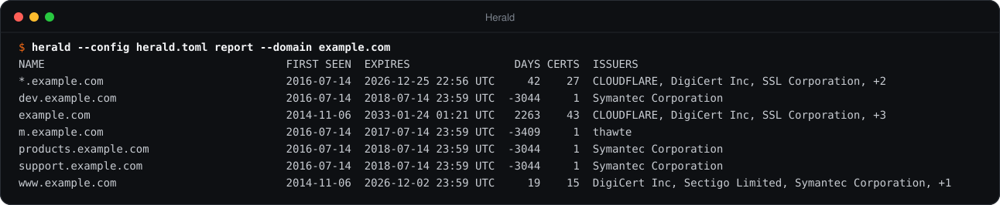
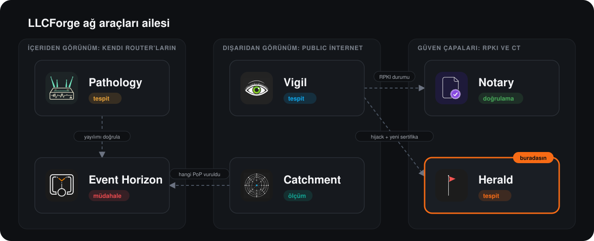

> **LLCForge ağ araçları** — kendi sunucunda, Rust, SaaS yok.
> [Pathology](https://github.com/LLCForge/Pathology) · [Event Horizon](https://github.com/LLCForge/Event-Horizon) · [Catchment](https://github.com/LLCForge/Catchment) · [Notary](https://github.com/LLCForge/Notary) · **Herald** · [Vigil](https://github.com/LLCForge/Vigil)

<!-- readme-visuals -->
<p align="center">
  
</p>

<p align="center">Certificate Transparency log izleyici. Domain'lerin için, onlara benzeyen ya da typosquat bir ad için veya CAA kayıtlarının izin vermediği bir CA tarafından yeni bir TLS sertifikası çıkarıldığı an alarm verir.</p>

<p align="center">
  <a href="README.md">English</a> · <strong>Türkçe</strong>
</p>

<p align="center">
  <a href="LICENSE"></a>
  
  
</p>

---

## Neden

Herkesçe güvenilen her TLS sertifikası Certificate Transparency'ye loglanmak zorundadır. Bu, domain'in için başkası tarafından çıkarılmış bir sertifikanın (bir phishing kiti, ele geçirilmiş bir DNS hesabı, hatalı sertifika veren bir CA) izliyorsan saniyeler içinde görünür olduğu anlamına gelir. Herald, üçüncü taraf bir arama servisine bağlı kalmadan log'ları doğrudan izler.

## Örnek çıktı

<p align="center">
  
</p>

<sub>`herald --config herald.toml report --domain example.com` komutunun gerçek çıktısı; envanter `herald backfill` ile public CT verisinden dolduruldu.</sub>

## Özellikler

- **İki CT log API'si birden.** RFC 6962 log'ları (`get-sth`, `get-entries`) ve static-ct-api tiled log'ları ([c2sp.org/static-ct-api](https://c2sp.org/static-ct-api): checkpoint, hash tile'ları, gzip'li data tile'ları); Let's Encrypt, Google, Sectigo, Geomys, GoDaddy ve TrustAsia tiled log'ları dahil. Log'lar Google'ın CT log listesi v3'ten gelir (durum `usable` / `qualified`, zaman dilimi bitmemiş), liste her gün yeniden okunur; yerine statik bir liste verilebilir.
- **Güvenilmez, doğrulanır.** Her tree head imzası kontrol edilir (`ring` ile ECDSA P-256 / RSA; tiled log'larda checkpoint içindeki RFC 6962 note imzası, anahtar kimliği spesifikasyondaki gibi). Art arda gelen tree head'ler tutarlı olmak zorundadır: klasik log'larda RFC 6962 `get-sth-consistency` kanıtları; tiled log'larda eski ve yeni kök aynı tile'lardan yeniden hesaplanır. Her data tile, içindeki girdiler kullanılmadan önce hash'lenir ve imzalı köke bağlanır. Bir hata kritik bir `log_inconsistent` alarmı üretir.
- **Uyarlanabilir paralellik.** Sayfalar / data tile'ları paralel çekilir; log geride kaldıkça paralellik artar, HTTP 429 / 5xx gelince yarıya iner (1 ile `fetch_concurrency` arasında). Tailer'lar kademeli başlar. Log başına en fazla 10 dakikaya kadar bekleme.
- **Tam kaldığı yerden devam.** Log başına checkpoint (sıradaki indeks + son doğrulanan tree head) her sayfa veya tile'dan sonra atomik olarak yazılır.
- **Eşleştirme:** birebir ad, alt domain'ler, wildcard'lar; tam Unicode TR39 confusables tablosuyla **benzer domain'ler** (`exаmple`, `examp1e`, `exarnple`); **typosquat'lar**: Damerau-Levenshtein mesafesi, tek bit çevrilmesi, TLD değişimi (`example.org` için `example.net`) ve birleşik adlar (`example-login`, `secure-example`).
- **CAA.** `caa = true` olan domain'lerde Herald CAA kayıtlarını çözer (DNS-over-HTTPS, UDP veya TCP; RFC 8659 ağaç tırmanma; `issue` / `issuewild`) ve izin verilen CA'ları beklenen sertifika veren olarak kabul eder. Başka bir CA'dan gelen sertifika kritik bir `caa_violation` alarmı üretir.
- **Envanter.** Eşleşen her sertifika `<data_dir>/inventory.json` dosyasında tutulur. `herald backfill` envanteri crt.sh'tan doldurur, `herald report` domain'lerin için görülen tüm host adlarını listeler (metin, Markdown, JSON) ve Herald, adlarından birinin en yeni sertifikasının süresi CT'de yenisi görünmeden dolmak üzereyse uyarır.
- **Kaldırma (takedown) takibi.** Benzer, typosquat ve şüpheli olarak işaretlenen sertifikalar CRL dağıtım noktalarına göre yeniden kontrol edilir (URL başına önbellekli); iptal edildiklerinde bildirilir.
- **Alarmlar [llcforge-alert](crates/llcforge-alert) üzerinden:** Telegram, HMAC imzalı webhook, Slack, Discord, Teams, e-posta, PagerDuty, Opsgenie, syslog, stdout. Kalıcı teslim kuyruğu, sink başına yeniden deneme ve hız sınırı, susturmalar (`herald silence`, `/v1/silences`) ve domain başına alıcılar: alarmın resource alanı izlenen domain'dir, yani `resources = ["example.org"]` o domain'i tek bir sink'e yönlendirir.
- **Telegram butonları.** İsteğe bağlı *Known*, *Suspicious* ve *Mute* butonlu kartlar (`getUpdates` long polling, kullanıcı izin listesi).
- **Yeniden başlatmaya dayanıklı tekilleştirme.** Bir ön sertifika ile son sertifikası tek alarm üretir; durum yeniden başlatmada korunur.
- **İşletim:** `/metrics`, `/healthz`, `/readyz`, JSON veya metin log'lar, yapılandırmayı yeniden yükleme (SIGHUP, dosya değişikliği, `POST /v1/reload`), Windows servisi / systemd / launchd, Docker, Helm, `deploy/` altında Grafana panosu ve Prometheus kuralları.
- `herald inspect`, bir sertifika dosyası için Herald'ın ne alarm vereceğini gösterir (isteğe bağlı canlı CAA ve CRL kontrolüyle).

## Ailedeki yeri

Herald, ailenin uygulama katmanındaki nöbetçisidir: [Vigil](https://github.com/LLCForge/Vigil) birinin IP alanını anons ettiğini söyler, Herald ise birinin az önce senin adına sertifika aldığını. Bir BGP hijack'in ardından aynı servis için yeni bir sertifika çıkarılması klasik bir trafik ele geçirme örüntüsüdür; ikisini birlikte çalıştırmak bu açığı kapatır.

<p align="center">
  
</p>

## Hızlı başlangıç

> **Durum:** yayın öncesi. Yapılandırma anahtarları ve CLI bayrakları 1.0'dan önce değişebilir.

Gereksinim: 1.85 veya daha yeni kararlı bir Rust araç zinciri ([rustup.rs](https://rustup.rs)). Linux, macOS ve Windows'ta sistem kütüphanesi gerekmez (TLS için rustls kullanılır).

```bash
git clone https://github.com/LLCForge/Herald.git
cd Herald
cargo build --release
cp herald.example.toml herald.toml      # sonra [[domain]] girdilerini düzenle
export HERALD_TELEGRAM_TOKEN="123456789:AA..."
./target/release/herald --config herald.toml check-config
./target/release/herald --config herald.toml backfill   # isteğe bağlı: envanteri crt.sh'tan doldur
./target/release/herald --config herald.toml run
```

En küçük `herald.toml` (diğer tüm anahtarların varsayılanı vardır; hepsi [herald.example.toml](herald.example.toml) dosyasında):

```toml
[[domain]]
name = "example.net"
include_subdomains = true
caa = true                             # CAA'nın izin verdiği CA'lar beklenir; diğerleri alarm üretir

[[domain]]
name = "example.org"
lookalikes = true
typosquats = true

[[alerts.sink]]
type = "telegram"
bot_token_env = "HERALD_TELEGRAM_TOKEN"
chat_id = -1001234567890
```

Gizli bilgiler her zaman yapılandırmada adı verilen ortam değişkenlerinden okunur, asla yapılandırma dosyasının kendisinden okunmaz. Herald 0.1 için yazılmış yapılandırmalar (`[alerts] stdout`, `[alerts.telegram]`, `[alerts.webhook]`) yüklenmeye devam eder: bunlar `[[alerts.sink]]` girdilerine çevrilir.

## Kurulum

| Platform | Nasıl |
|---|---|
| Linux (Debian/Ubuntu) | Sürüm sayfasından `sudo apt install ./herald_<sürüm>_amd64.deb`; `/etc/herald/herald.toml` dosyasını düzenle, gizli bilgileri `/etc/herald/herald.env` dosyasına koy, sonra `sudo systemctl enable --now herald`. Unit dosyası (`packaging/systemd/herald.service`) `DynamicUser=yes`, `StateDirectory=herald` ve sıkı bir sandbox ile çalışır; `systemctl reload herald` yapılandırmayı yeniden okur. |
| Linux (RHEL/Fedora/openSUSE) | `sudo dnf install ./herald-<sürüm>.x86_64.rpm`, sonra aynı systemd adımları. |
| macOS | `brew install LLCForge/tap/herald` (formül `packaging/homebrew/` altında) veya sürüm arşivi. Arka planda çalıştırmak için `packaging/launchd/net.llcforge.herald.plist`; `herald service install` tam `launchctl` adımlarını yazdırır. |
| Windows | `scoop install herald` (manifest `packaging/scoop/` altında) veya `winget install LLCForge.Herald`. Servis olarak: yönetici PowerShell'de `packaging/windows/install-service.ps1` ya da `herald --config C:\ProgramData\LLCForge\herald\herald.toml service install`. Ayrıntılar [packaging/windows/README.md](packaging/windows/README.md) dosyasında. |
| Docker | [docker-compose.yml](docker-compose.yml) ile `docker compose up -d` (salt okunur kök dosya sistemi, yetki yok, durum `/data` volume'ünde). Konteyner içinde `[metrics] listen = "0.0.0.0:9898"` ayarla. |
| Kubernetes | `helm install herald deploy/helm/herald -f benim-values.yaml`; chart, 9898 portunda `/healthz` ve `/readyz` yoklar ve ServiceMonitor oluşturabilir. |
| Kaynaktan | `cargo install --path .` (Rust 1.85+ olan her işletim sistemi). |

Herald hiçbir işletim sisteminde özel yetki istemez: yalnızca dışarıya HTTPS bağlantıları (ve `caa.resolver = "udp://..."` veya `"tcp://..."` ile DNS bağlantıları) açar ve yapılandırdığın yönetim portunu dinler.

## Kullanım

```text
herald [--config <DOSYA>] <KOMUT>

  run                       CT log'larını izle ve alarm gönder (Ctrl+C / SIGTERM temiz durdurur)
  check-config              Yapılandırmayı doğrula, eksik ortam değişkenlerini bildir
  inspect DOSYA [--caa] [--revocation]
                            Bir sertifika (PEM veya DER) için Herald'ın ne alarm vereceğini göster
  test-alert                Yapılandırılmış her sink'e bir test alarmı gönder
  backfill [--domain D]     Envanteri crt.sh'tan doldur (alarm gönderilmez)
  report [--format text|markdown|json] [--domain D]
                            Domain'lerin için CT'de görülen tüm host adları, süreleriyle
  silence add|list|remove   Susturmalar / bakım pencereleri
  service install|uninstall|run
                            Windows servisi; Unix'te systemd / launchd adımlarını yazdırır
```

`--config` varsayılanı `herald.toml`'dur. `HERALD_LOG` (örneğin `HERALD_LOG=debug`) `[logging]` seviyesinin önüne geçer. Log'lar stderr'e gider; stdout sink'i alarmları stdout'a yazar.

### Alarm türleri

| Tür | Önem | Ne zaman |
|---|---|---|
| `certificate` | warning | Adlarından biri için beklenmeyen bir sağlayıcıdan yeni sertifika |
| `lookalike` | critical | Domain'ine görsel olarak benzeyen bir ad (TR39 iskelet eşleşmesi) |
| `typosquat` | critical | Düzenleme mesafesi, bit çevrilmesi, TLD değişimi veya birleşik ad |
| `caa_violation` | critical | Sertifikayı veren CA, domain'in CAA kayıtlarında izinli değil |
| `cert_expiring` | warning | Adlarından birinin en yeni sertifikası `expiry_warn_days` içinde doluyor; yenisi görününce çözülür |
| `cert_revoked` | info | Takip edilen benzer / typosquat / şüpheli sertifika iptal edildi |
| `cert_suspicious` | critical | Biri Telegram kartında *Suspicious* butonuna bastı |
| `log_inconsistent` | critical | Bir CT log'u tutarsız tree head'ler sundu |

Her alarmın `resource` alanı izlenen domain'dir (`log_inconsistent` için CT log URL'si); böylece `resources = ["example.org"]` ve `kinds = ["lookalike", "typosquat"]` gibi sink filtreleriyle domain başına alıcı tanımlanır.

### Telegram kurulumu

1. [@BotFather](https://t.me/BotFather) ile sohbet aç, `/newbot` gönder ve adımları izle. BotFather `123456789:AA...` gibi bir token verir.
2. Token'ı yapılandırmaya değil ortama koy: `export HERALD_TELEGRAM_TOKEN="123456789:AA..."`.
3. Sohbet kimliğini bul:
   - Özel sohbet: bota bir mesaj gönder, sonra `https://api.telegram.org/bot<TOKEN>/getUpdates` adresini aç ve `message.chat.id` değerini oku (pozitif bir sayı).
   - Grup: botu gruba ekle, gruba bir mesaj yaz ve aynı `getUpdates` çağrısından `chat.id` değerini oku (negatif; süper gruplar `-100` ile başlar).
   - Herkese açık kanal: botu yönetici olarak ekle ve `chat_id = "@kanalin"` kullan.
4. `type = "telegram"` olan bir `[[alerts.sink]]` ekle ve `herald test-alert` çalıştır.

**Butonlar.** `[telegram_actions]` ile Herald her sertifika alarmını ayrıca bir kart olarak gönderir: *Known* (kararı envantere yazar), *Suspicious* (karar, kritik `cert_suspicious` alarmı ve iptal takibi) ve *Mute Nd* (o domain ve alarm türü için bir susturma). Kartlar için ayrı bir bot kullan: bir bot için yalnızca bir program `getUpdates` çağırabilir. Basışlar yalnızca yapılandırılmış sohbette ve yalnızca `allowed_user_ids` içindeki kullanıcılardan kabul edilir.

### Webhook imzaları

`hmac_secret_env` ayarlıysa her webhook isteği `X-LLCForge-Timestamp` ve `X-LLCForge-Signature: sha256=<hex>` = HMAC-SHA256(gizli, `"<timestamp>.<ham gövde>"`) başlıklarını taşır. Beş dakikadan eski istekleri reddet. Python ile bir alıcı örneği [llcforge-alert README](crates/llcforge-alert/README.md#verifying-webhook-signatures) dosyasında.

### Yapılandırma başvurusu

| Anahtar | Varsayılan | Anlamı |
|---|---|---|
| `data_dir` | `$STATE_DIRECTORY` veya `herald-data` | Checkpoint'ler, tekilleştirme durumu, envanter, alarm kuyruğu, susturmalar |
| `logs.list_url` | Google log listesi v3 | Yüklenecek CT log listesi |
| `logs.include_tiled` | `true` | Listedeki static-ct-api log'larını da izle |
| `logs.list_refresh_secs` | `86400` | Log listesinin yeniden okunma aralığı (en az 60) |
| `logs.poll_interval_secs` | `10` | Her log'un tree head / checkpoint'inin yoklanma aralığı |
| `logs.batch_size` | `256` | `get-entries` sayfası başına girdi (1 ile 1024; log'un sınırına otomatik iner) |
| `logs.fetch_concurrency` | `4` | Log başına en fazla paralel sayfa / data tile (1 ile 64); tailer bunun altında uyarlanır |
| `logs.backfill` | `0` | Bir log ilk kez başlarken tree head'den bu kadar girdi geriden başla |
| `logs.verify_sth` | `true` | İmzaları, tutarlılığı ve tile hash'lerini doğrula |
| `[[logs.static]]` | yok | `url`, isteğe bağlı `key` (base64 SPKI), `description`, `tiled`, `origin`; log listesinin yerine geçer |
| `dedup.window_secs` | `86400` | Ön sertifika ile son sertifikanın tek alarm ürettiği pencere |
| `[[domain]] name` | zorunlu | İzlenecek domain (Unicode adlar punycode'a çevrilir) |
| `include_subdomains` | `false` | Domain altındaki her adı eşleştir |
| `wildcards` | `true` | `*.<ad>` eşleştir |
| `lookalikes` | `false` | TR39 confusable benzerleri |
| `typosquats` / `typo_distance` | `false` / `1` | Typosquat tespiti; en fazla düzenleme mesafesi 1 ile 3 |
| `caa` | `false` | Beklenen sağlayıcılar CAA'dan, aksi halde `caa_violation` |
| `expected_issuers` | `[]` | Eşleşmeleri susturulan sertifika sağlayıcı O veya CN değerleri (büyük/küçük harf duyarsız) |
| `[alerts]`, `[[alerts.sink]]` | bir stdout sink'i | [llcforge-alert](crates/llcforge-alert/README.md#configuration) belgesine bak; ortak sink anahtarları `resources`, `kinds`, `min_severity`, `rate_per_minute` |
| `caa.resolver` | `https://cloudflare-dns.com/dns-query` | DoH URL'si, `udp://sunucu[:port]` veya `tcp://sunucu[:port]` |
| `caa.refresh_secs` | `3600` | CAA'nın yeniden çözülme aralığı |
| `[caa.issuer_domains]` | yerleşik tablo | Ek sağlayıcı kuruluşu ile CAA kimliği eşlemeleri |
| `inventory.expiry_warn_days` | `14` | Süre dolumu uyarı penceresi (0 kapatır) |
| `inventory.check_interval_secs` | `3600` | Süre ve iptal kontrol aralığı |
| `inventory.revocation_check` | `true` | Takip edilen benzer / typosquat sertifikalar için CRL kontrolü |
| `inventory.max_certs` | `100000` | Envanter boyut sınırı |
| `[telegram_actions]` | yok | `bot_token_env`, `chat_id`, `allowed_user_ids`, `mute_days` (`7`) |
| `[silences] api_token_env` | yok | `/v1/silences` uç noktasını açar |
| `[health] admin_token_env` | yok | `POST /v1/reload` uç noktasını açar |
| `[logging] format` / `level` | `text` / `info` | Satır başına bir nesne için `json` |
| `metrics.listen` | yok | Yönetim dinleyicisi: `/metrics`, `/healthz`, `/readyz` ve yönetim API'leri. `[metrics]` yoksa `[health] listen` kullanılır. |

Bilinmeyen anahtarlar reddedilir; böylece bir yazım hatası yok sayılmak yerine başlangıçta hata verir. Yapılandırmanın yeniden yüklenmesi tailer'ları checkpoint'lerinden yeniden başlatır; yönetim dinleyicisinin adresini değiştirmek süreç yeniden başlatması gerektirir.

### Benzer domain ve typosquat tespiti nasıl çalışır

Her sertifika adı punycode'dan Unicode'a çözülür ve bir iskelete indirgenir: küçük harf, Herald'ın küçük ek tablosu (`0 1 3 5` rakamları `o l e s` olarak, Latin'e benzeyen Kiril ve Yunan harfleri), NFD, tam Unicode TR39 confusables eşlemesi (6.700'den fazla girdi, örneğin `m` için `rn`), yeniden NFD, birleşik işaretlerin atılması. İskelet senin domain'inin iskeletine eşitse veya `.<iskelet>` ile bitiyorsa ve gerçek ad senin domain'inin altında değilse, bu bir benzer domain'dir.

Typosquat tespiti adın kayıt edilebilir kısmını (domain'in kaç etiketten oluşuyorsa sondan o kadar etiket; `example.co.uk` için üç etiket) domain'inle karşılaştırır: aynı sonek ve `typo_distance` değerine kadar Damerau-Levenshtein mesafesi (`exampel`, `exmple`, `examples`), tek bit çevrilmesi (`exampme`), başka bir sonek altında aynı etiket (`example.net`) veya etiketinin daha uzun bir etiketin içinde geçmesi (`example-login`, `secure-example`; yalnızca dört ve daha uzun karakterli etiketler için). Public Suffix List kullanılmaz; kısa etiketlerde birleşik adlar gürültülü olabilir.

## Yol haritası

- CRL imzaları doğrulanmaz (Herald CT'de güvenilir bir sağlayıcı sertifikası değil, yalnızca yaprak veya TBS sertifikayı görür); bu yüzden iptal sonuçları bilgi amaçlıdır. OCSP kullanılmaz.
- Tiled log'ların kısmi data tile'ları, tam tile beklenmeden her yoklamada çekilir (daha basit, biraz daha fazla trafik).
- Typosquat tespitinde Public Suffix List yoktur; kayıt edilebilir kısım son N etikettir, N yapılandırdığın domain'in etiket sayısıdır.
- CAA sağlayıcı tablosu büyük public CA'ları kapsar; diğerleri için `[caa.issuer_domains]` gerekir. CAA alt domain başına değil, izlenen domain için (ağaç tırmanmayla) değerlendirilir.
- Backfill yalnızca crt.sh'ı okur; log'ların kendisinin tam tarihsel taraması uygulanmadı (yakın geçmiş için `logs.backfill`).
- Telegram eylem kartları normal Telegram sink'inden ayrı mesajlardır (ortak sink buton desteklemez).

## Nasıl çalışır

Bileşenler, veri akışı, güven sınırları ve hata senaryoları için [ARCHITECTURE.md](ARCHITECTURE.md) dosyasına bak.

## İlgili araçlar

- [Vigil](https://github.com/LLCForge/Vigil): Public RIPE RIS ve RouteViews feed'leri üzerinden gerçek zamanlı origin hijack tespiti. Başka biri prefix'ini anons ettiği an işaretler.
- [Notary](https://github.com/LLCForge/Notary): RPKI Route Origin Validation denetleyicisi. Prefix'lerinin RPKI-valid olup olmadığını söyler ve üçüncü taraf AS'leri milisaniyeler içinde izler.
- [Pathology](https://github.com/LLCForge/Pathology): Kendi router'ların ve BMP beslemelerin için BGP rota izleyici. Prefix'lerinin normalde kullandığı AS path'leri ve origin'leri öğrenir, en küçük sapmada alarm verir.

## Katkı

Issue ve pull request'ler memnuniyetle karşılanır. Önce [CONTRIBUTING.md](CONTRIBUTING.md) ve [Davranış Kuralları](CODE_OF_CONDUCT.md) dosyalarını oku. Bir güvenlik açığı mı buldun? Public issue **açma**; [SECURITY.md](SECURITY.md) adımlarını izle.

## Lisans

Herald, [MIT Lisansı](LICENSE) ile yayınlanan özgür ve açık kaynak bir yazılımdır. Atıflar için [NOTICE](NOTICE) dosyasına bak.
